<div class="caratula">

<p class="dato">Universidad del Norte Santo Tomás de Aquino · Facultad de Ingeniería</p>
<p class="dato">Ingeniería en Informática / SEMINARIO I</p>

<p class="rotulo">Trabajo</p>
<h1>GEMELOS DIGITALES</h1>

<p class="rotulo">Proyecto</p>
<p class="dato"><strong>SCARA</strong> · brazo robótico de cuatro grados de libertad con teach &amp; play, simulado en Webots</p>

<p class="rotulo">Equipo</p>
<p class="dato">Alan Turing</p>

<p class="rotulo">Integrantes</p>
<p class="dato">Albarracin Ignacio · Antenucci Mateo · Grosso Luciano · Villalobo Evaristo</p>

<p class="rotulo">Docente</p>
<p class="dato">Ing. Gustavo Sbrugnera</p>

<p class="rotulo">Año académico</p>
<p class="dato">2026</p>

</div>

<!-- SALTO DE PAGINA -->

# Homenaje

**En homenaje a Alan Turing**

<figure>
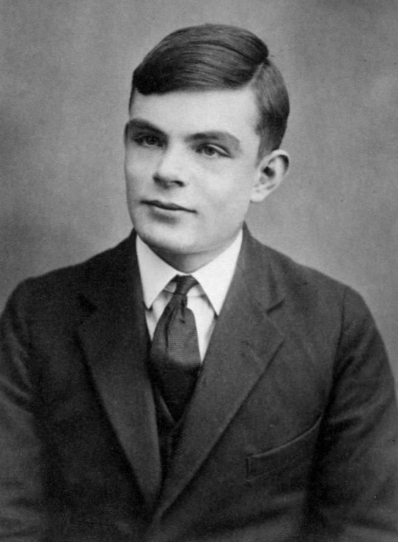
<figcaption>Alan Mathison Turing (Londres, 1912 – Wilmslow, 1954), a los 16 años. Fotografía de 1928–1929, de dominio público (Turing Archive, King's College, Cambridge, vía Wikimedia Commons).</figcaption>
</figure>

Elegimos a Alan Turing como nombre del equipo porque buena parte de lo que hicimos en este trabajo descansa sobre ideas suyas. En 1936, con veinticuatro años, publicó «On Computable Numbers», donde definió una máquina abstracta que lee y escribe símbolos según una tabla de reglas, y demostró que existe una máquina *universal* capaz de imitar a cualquier otra si se le da la descripción de esa otra. Con eso fijó qué significa calcular y dónde están los límites de lo que una máquina puede resolver. Un gemelo digital es, en el fondo, esa misma idea llevada a la práctica: una computadora que se comporta como otra máquina, siguiendo su descripción, al punto de que el programa que la controla no nota la diferencia.

Durante la Segunda Guerra Mundial trabajó en Bletchley Park descifrando los mensajes que la marina alemana cifraba con la máquina Enigma. La *bombe* que diseñó, a partir del trabajo previo de los criptógrafos polacos, permitió leer las comunicaciones de los submarinos del Atlántico y se considera que acortó la guerra. Terminado el conflicto diseñó el ACE, una de las primeras computadoras de programa almacenado, trabajó en la de Manchester y en 1950 planteó la pregunta de si las máquinas pueden pensar, con la prueba que hoy lleva su nombre. Hacia el final de su vida estudió cómo se forman los patrones en los seres vivos, un trabajo que abrió el camino a la biología matemática.

En 1952 fue condenado por su homosexualidad y obligado a someterse a un tratamiento hormonal; murió dos años después, a los cuarenta y uno. El gobierno británico le pidió perdón públicamente en 2009 y la Corona lo indultó en 2013. Hoy el premio más importante de la informática lleva su nombre. Lo recordamos por lo que aportó y también por lo que se le negó: buena parte de la disciplina que estudiamos se apoya en el trabajo de alguien que su propio país no supo proteger.

<!-- SALTO DE PAGINA -->

## Contenido

1. Equipo a simular
2. Descripción funcional del software externo
3. Protocolo
4. Interconexión lógica
5. Pila tecnológica
6. Observaciones finales

Anexo A. Archivos entregados y cómo ejecutarlos

**Alcance de este informe.** Siguiendo la consigna, no repite la documentación oficial del robot (el documento maestro de la cátedra): reseña lo que tiene que ver con la virtualización. La sección 3, el protocolo, es el aporte central: el SCARA no tenía protocolo ni programa externo, y los dos se diseñaron en este trabajo.

**Una advertencia que vale para todo el documento.** El SCARA no está construido: no hay un robot físico con el que comparar el modelo. El gemelo digital simula el *diseño*. Cada parámetro declara su procedencia (CAD, maestro v1, hoja de datos de la familia más cercana o supuesto) y ninguno se presenta como una medición.

<!-- SALTO DE PAGINA -->

## 1. Equipo a simular

### 1.1 Descripción general

Tomada de la consigna del trabajo final:

> SCARA es un brazo robótico de tipo SCARA, que se está desarrollando en el Laboratorio. Sus movimientos se controlan desde cuatro motores paso a paso, no retroalimentados. En el extremo se montará un sencillo electroimán, para demostraciones de "pick & place".
>
> Estado del proyecto: no construido; no disponible; no operativo. Estado del protocolo: no redactado. Estado del programa externo: no desarrollado.
>
> Objetivos: Desarrollar un esquema similar al planeado en AGSA-BOT y CARTESIANA: un programa externo deberá registrar puntos de una trayectoria, y luego ejecutarla. Este programa se comunicará con el controlador de WeBots a través de TCP/IP.

En la clase del 27/10/2026 el profesor precisó el objetivo como *teach & play*: mover el robot a mano desde el programa externo, guardar puntos, armar trayectorias con nombre y reproducirlas siguiendo rectas o el menor recorrido. También fijó que los modelos de SolidWorks son la fuente de verdad cuando difieren del maestro v1.

### 1.2 Descripción estructural

El robot es un SCARA de cuatro articulaciones en cadena serie R-R-R-P: J1 (hombro), J2 (codo) y J3 (muñeca) giran sobre ejes verticales, y J4 desplaza verticalmente el pistón que lleva la herramienta. Una torre de chapa de acero de 200 mm sostiene el brazo; el brazo (L1) y el antebrazo (L2) son caños de aluminio de 50 × 50 mm con **250 mm entre ejes** cada uno, así que el extremo alcanza un radio de 500 mm. Los recorridos son de ±135° en J1 y J2, ±150° en J3 y 0–120 mm en J4, positivo hacia abajo. El espacio de trabajo es un cilindro de 1000 mm de diámetro y 120 mm de altura.

Lo propio de este SCARA, y lo que más pesa en la simulación, es la **cadena cinemática híbrida**: los motores de J1 y J2 están en la base y mueven dos ejes concéntricos. El exterior gira el brazo; el interior lleva una polea que, por una correa a lo largo del brazo, gira el antebrazo. Por eso el motor M2 fija el ángulo *absoluto* del antebrazo, no el ángulo relativo J2:

```text
J1 = θM1 / 4        J2 = (θM2 − θM1) / 4        J3 = θM3 / 4        J4 = 8 mm × vueltas de M4
```

Mover solo M1 gira el brazo y cambia J2 en sentido opuesto: el antebrazo conserva su orientación en el mundo. Para mover solo J1, el firmware da la misma cantidad de pasos a M1 y a M2. La simulación reproduce ese acople paso a paso.

**En Webots.** El modelo (`webots/protos/SCARA.proto`, usado por el mundo `webots/worlds/scara_uci.wbt`) se armó con las piezas de SolidWorks convertidas a STL (sldprt2step y OpenCascade), colocadas con las transformaciones recuperadas de los ensambles. Tiene tres `HingeJoint` (J1–J3) y un `SliderJoint` (J4), masas e inercias calculadas del CAD con densidades nominales y envolventes de colisión simplificadas por cuerpo rígido. El robot es un `supervisor` para que la planta simulada pueda aplicar cargas, obstáculos y el «movido a mano».

### 1.3 Sensores

El diseño **no tiene encoders**: la posición se estima contando pasos. El maestro v1 prevé «sensores de inicio y final de carrera en los cuatro ejes, con imanes de neodimio y sensores de efecto Hall», sin ubicación ni cantidad. El grupo propuso al profesor **un sensor KY-003 por articulación**, en la pieza fija, y **dos imanes** en la pieza móvil, centrados en los extremos del recorrido con una zona activa de ±5° (±3 mm en J4). El de un extremo es la referencia del *homing*; el del otro, protección por sobrerrecorrido. Además, el firmware usa cada cruce de un imán para detectar pasos perdidos (`EV LOST`, sección 3).

En Webots, cada KY-003 es un `Receiver` y cada imán un `Emitter`. Como Webots no entrega paquetes dentro de un mismo robot, la planta simulada mide la distancia entre los dos nodos y activa el Hall cuando el imán está dentro de su alcance: la activación sale de la geometría del modelo, no de leer la posición perfecta del simulador. Los cuatro `PositionSensor` de Webots no los ve el firmware: solo alimentan el canal de instrumentación, que muestra la posición física simulada al lado de la estimada.

### 1.4 Actuadores

| Motor | Articulación | Modelo (maestro v1) | Transmisión |
| --- | --- | --- | --- |
| M1 | J1 | Minebea 23KM-K381-P1, NEMA 23, 1,8° | Polea GT2 20T → 80T (4:1) sobre el eje exterior |
| M2 | J1 + J2 | Minebea 23KM-K381-P1, NEMA 23, 1,8° | 20T → 80T sobre el eje interior, y 60T → 60T hasta el codo |
| M3 | J3 | Shinano Kenshi STP-42D221-03, NEMA 17 | 20T → 80T (4:1), montado en el antebrazo |
| M4 | J4 | 42D265, NEMA 17, 0,7 A | Acople flexible y varilla ACME de 8 mm por vuelta |

Cada motor tiene un driver **TB6600**. El grupo propuso al profesor configurarlos a **1/8 de paso** (1600 pulsos por vuelta) en lugar de los 400 del maestro: con 400, un pulso de M1 mueve el extremo casi 2 mm con el brazo estirado y una recta se vería escalonada; con 1/8, medio milímetro. Es un único parámetro del firmware (`firmware/config.h`).

En la simulación, cada motor es un rotor que sigue a los pulsos con el par de su curva par–velocidad (modelo N2): si la carga o la aceleración piden más par, el rotor cae al equilibrio siguiente y **pierde cuatro pasos completos sin que el firmware se entere**, como un paso a paso real. Las articulaciones de Webots se comandan en velocidad para seguir a esos rotores. Sin corriente, el motor no retiene: J4 cae por su peso.

### 1.5 Unidad de control

La unidad de control (UCI) es un **Arduino UNO** en un gabinete separado del brazo, conectado a la PC por USB-serie a 115 200 baudios. Usa 13 de sus 20 pines (STEP y DIR de cada motor, un ENABLE común y una entrada por Hall), más los dos del puerto serie, y deja libres los del shield Ethernet. Los pulsos los genera una interrupción del Timer1 a 20 kHz: hasta 10 000 pasos por segundo por motor.

El firmware es **uno solo**, en C++ portable y sin memoria dinámica ni flotantes (`firmware/`), y corre igual en el UNO y dentro del controlador de Webots: solo cambia la capa de hardware. Compilado para el UNO ocupa 16 148 bytes de flash (50 %) y 1297 bytes de RAM global (63 %). No hay placa: el firmware compila para el UNO y su camino serie se ensayó con un puerto serie virtual y socat.

### 1.6 Imágenes del prototipo

El robot no se construyó: no hay fotografías de la máquina real. Las dos primeras imágenes son renders del diseño en SolidWorks, de la cátedra; las dos siguientes, el modelo en Webots.

<div class="fotos">
<figure>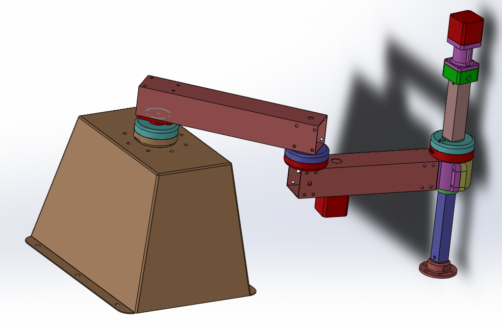<figcaption>Figura 1. Render del diseño (SolidWorks, cátedra).</figcaption></figure>
<figure>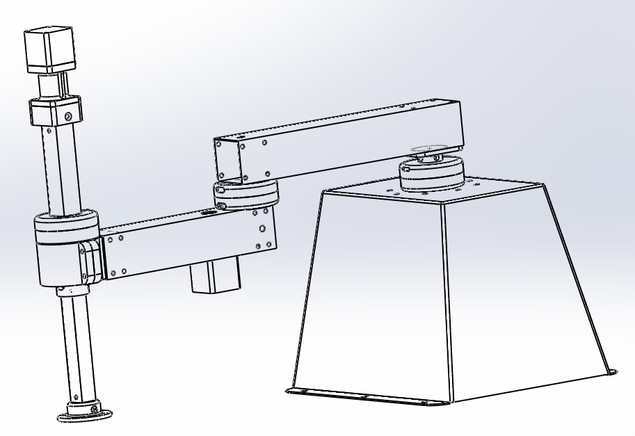<figcaption>Figura 2. Vista de líneas: torre, brazo, antebrazo y columna Z.</figcaption></figure>
</div>

<div class="fotos">
<figure>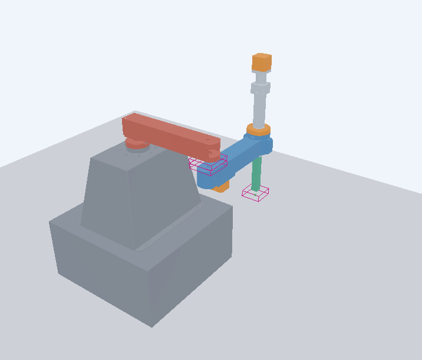<figcaption>Figura 3. Modelo articulado en Webots, con las envolventes de colisión de la muñeca y la herramienta.</figcaption></figure>
<figure>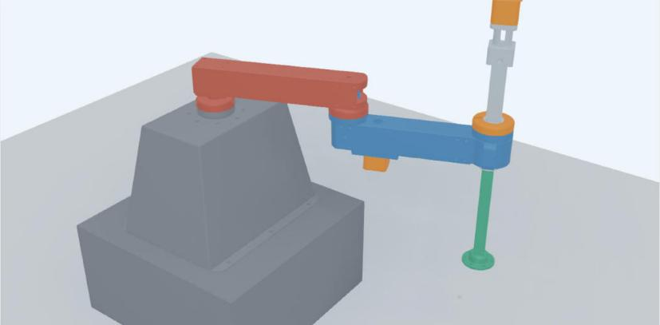<figcaption>Figura 4. El gemelo en Webots, después de un jog de J1 enviado desde la URC.</figcaption></figure>
</div>

<!-- SALTO DE PAGINA -->

## 2. Descripción funcional del software externo

### 2.1 El programa externo: la URC

El programa externo del SCARA se desarrolló en este trabajo: la **URC** (Unidad Remota de Coordinación), una aplicación en Python que corre en la PC y se opera desde una **página web local**. Se diseñó para que sea **la misma con el robot real y con la simulación**: habla `scara/1` por TCP y no sabe si del otro lado hay un Arduino o Webots.

### 2.2 Responsabilidades

El reparto entre la URC y el firmware es el de GRBL y Klipper: **la URC planifica y el firmware ejecuta**.

| La URC | El firmware de la UCI |
| --- | --- |
| Servidor TCP de `scara/1`; saluda (`HELLO`) y mantiene vivo el enlace (`PING` cada 250 ms) | Interpreta `scara/1` y valida la forma de cada orden |
| Cinemática directa e inversa, configuración del codo | Convierte unidades articulares a pasos y resuelve el acople M1/M2 |
| Planifica tramos PTP y LIN con perfil trapezoidal y los parte en segmentos de 20 ms | Encola hasta 16 segmentos y los ejecuta con su propio reloj |
| Verifica antes de mover: límites, alcance, velocidades y aceleraciones de los motores, cambio de codo y colisiones | Verifica que ningún segmento supere la velocidad de un motor (`ERR 8`) |
| Jog articular, cartesiano y por motor desde el teclado; jog verificado con referencia | Jog lento sin referencia; el Hall frena como fin de carrera |
| Gestor de trayectorias: capturar, escribir, editar, reordenar, guardar y cargar (JSON) | Homing autónomo con los Hall (`HOME`) |
| Reproducción con loop, pausa y reanudación sobre la misma recta | Paradas `STOP` (con rampa) y `HALT` (en seco); watchdog de 1 s |
| Registro de eventos, avisos y estado del enlace | Detecta pasos perdidos al cruzar un Hall (`EV LOST`) |
| Banco de ensayo (solo simulación): fallas, carga, obstáculos | Anuncia cada arranque (`BOOT`) |

### 2.3 Requisitos para su funcionamiento

- **Python 3** (probado con 3.15 en macOS y con Python 3 en Windows 11). La URC usa solo la biblioteca estándar: no hay que instalar paquetes.
- **Un navegador** moderno (Chrome, Edge, Safari) en la misma PC: la URC escucha solo en `127.0.0.1:8766` y rechaza órdenes de otro origen.
- **Webots R2025a** con el controlador `scara_uci` compilado (en macOS, con las Command Line Tools de Xcode; en Windows, con el `g++` que trae Webots). La simulación debe correr en **tiempo real, a 1× o menos**: el watchdog del firmware cuenta tiempo simulado y la URC envía `PING` en tiempo real.
- Con el robot real, en lugar de Webots: el Arduino UNO por USB y **socat** para puentear el puerto serie al TCP 9000.
- Puertos libres: 8766 (página), 9000 (`scara/1`) y 9001 (canal de instrumentación).

Se arranca con `python3 -m urc.app` desde la raíz del repositorio; el orden respecto de Webots no importa, porque el controlador reintenta la conexión cada segundo.

### 2.4 La interfaz de usuario

La página separa lo que vale ahora (barra de estado fija arriba: enlace, motores, referencia, qué hace el robot, carga y fallas), lo que hay que ver enseguida (avisos emergentes) y lo que pasó (registro de eventos numerado a la derecha). Un botón que la URC rechazaría por el estado del robot aparece deshabilitado y dice por qué. Las cuatro capturas son de una corrida real del 07/11/2026 con Webots.

<figure class="captura">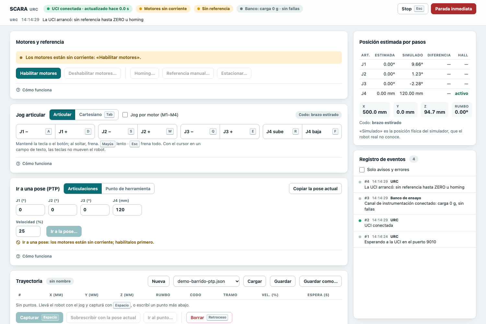<figcaption>Figura 5. La UCI recién conectada: motores sin corriente y sin referencia. La columna «Simulado» llega por el canal de instrumentación: el mundo arranca con un desvío al azar de hasta ±10°, y la posición estimada por pasos todavía no lo sabe.</figcaption></figure>

<figure class="captura">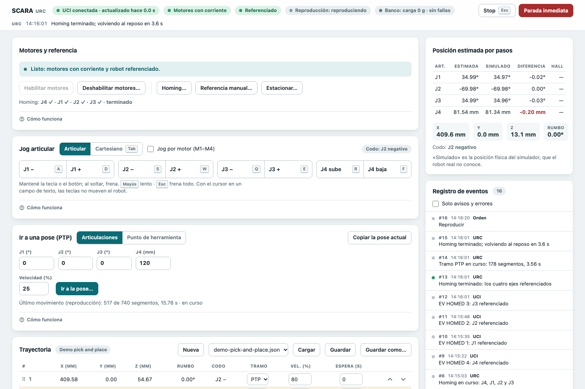<figcaption>Figura 6. Referenciado tras el homing (J4, J1, J2, J3), reproduciendo la demostración <em>pick and place</em>: tramos PTP y LIN, con espera de 1 s abajo. El punto resaltado es al que va el tramo en ejecución.</figcaption></figure>

<figure class="captura">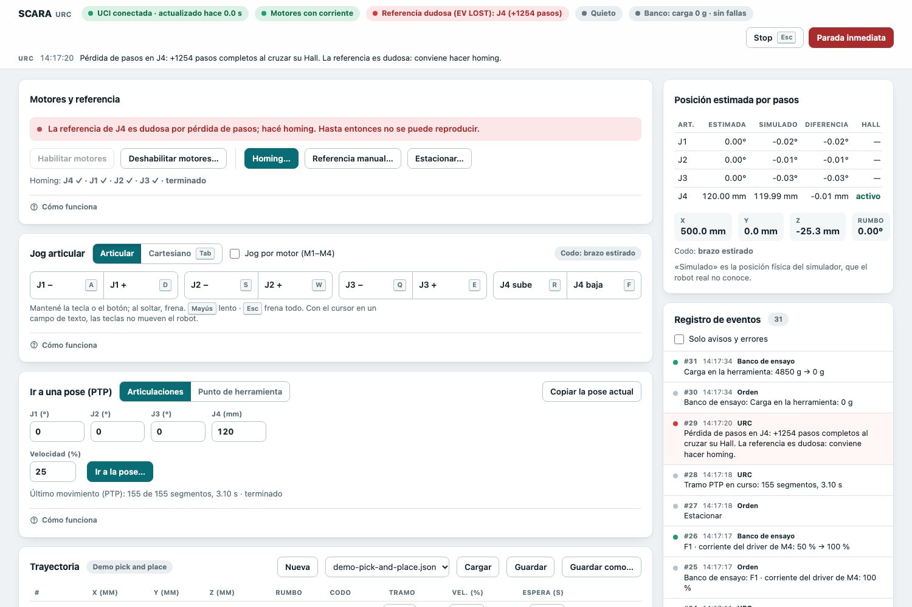<figcaption>Figura 7. Falla F1 inyectada: con 5 kg y el driver de M4 al 50 %, J4 no subió. Al volver al reposo, el Hall de abajo delató 1254 pasos perdidos (<code>EV LOST 4 1254</code>): la barra marca la referencia dudosa en rojo y la reproducción queda bloqueada hasta un homing.</figcaption></figure>

<figure class="captura">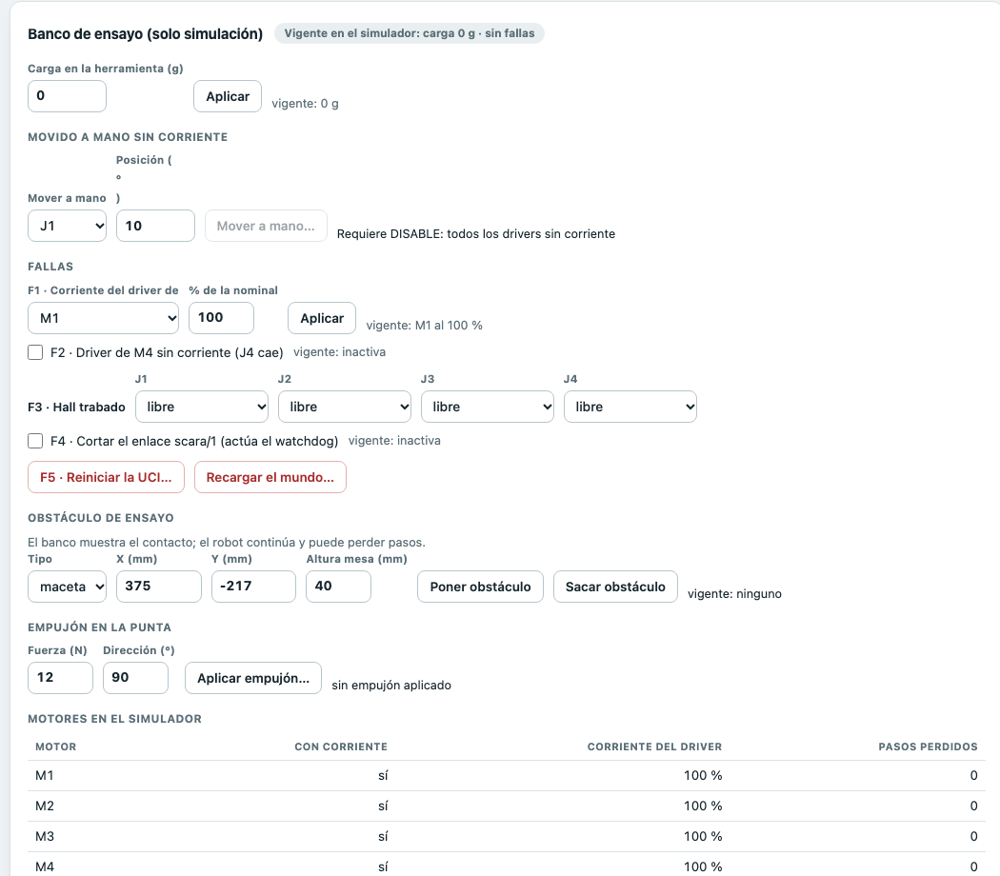<figcaption>Figura 8. Banco de ensayo, que solo aparece con la simulación: carga, movido a mano, fallas F1–F5, obstáculos, empujón en la punta y el estado de cada motor simulado.</figcaption></figure>

**Teclado.** Con la página enfocada, el jog es «estilo videojuego»: A/D, W/S, Q/E y R/F mueven J1, J2, J3 y J4 en jog articular, o Y, X, rumbo y Z en jog cartesiano (Tab cambia de modo, Mayús lo hace lento); Espacio captura el punto, Retroceso lo borra, Enter termina la trayectoria y Esc frena todo.

<!-- SALTO DE PAGINA -->

## 3. Protocolo

### 3.1 Panorama: tres enlaces

| Enlace | Extremos | Transporte | Formato | Existe con el robot real |
| --- | --- | --- | --- | --- |
| **`scara/1`** | URC ⇄ UCI (firmware) | TCP 9000; con el UNO, USB-serie 115 200 puenteado por socat | Texto ASCII, una línea por mensaje | Sí: es el protocolo del robot |
| **`scara-sim/1`** | URC ⇄ controlador de Webots | TCP 9001 | Texto ASCII, una línea por mensaje | No: solo existe en la simulación |
| HTTP | Navegador ⇄ URC | HTTP 8766 en `127.0.0.1` | JSON | Sí (es interno del programa externo) |

`scara/1` es el contrato entre el programa externo y la máquina, y el que exige la consigna. `scara-sim/1` lleva lo que el robot real no podría dar (la posición física verdadera) y lo que solo tiene sentido en la simulación (inyectar fallas, cambiar la carga, recargar el mundo). Separarlos fue una decisión deliberada: si la verdad del simulador viajara por `scara/1`, la URC podría terminar dependiendo de ella sin querer, y dejaría de funcionar con el robot real. Una prueba automática verifica que la sesión, el planificador y la validación de la URC no importen el módulo del canal de instrumentación.

La especificación normativa de `scara/1` está en `docs/PROTOCOLO_SCARA_1.md`, y la de `scara-sim/1`, en `docs/PROTOCOLO_SCARA_SIM_1.md`. Esta sección las reúne y las completa con la máquina de estados, la temporización y diálogos reales.

### 3.2 `scara/1`: medio, roles y conexión

**Medio.** TCP/IP sobre la interfaz local (`127.0.0.1:9000`, configurable con `--uci-port`). Con el robot real, el UNO habla por **USB-serie a 115 200 baudios, 8N1**, y `socat` puentea ese puerto al mismo TCP 9000 (`socat /dev/cu.usbmodem1101,b115200,rawer TCP:127.0.0.1:9000`): la URC no cambia. Es una conexión **full-duplex**: los dos lados escriben cuando lo necesitan, sin turnos.

**Cliente y servidor.** La **URC es el servidor**: escucha en el 9000 y queda siempre esperando. La **UCI es el cliente**: el controlador de Webots se conecta y, si la URC no está, reintenta cada segundo sin frenar la simulación; con el robot real, el cliente es socat. Así el robot puede reiniciarse o reconectarse sin tocar la URC, y el mismo esquema sirve para Webots, para socat y para un futuro UNO con shield Ethernet. La URC atiende una sola UCI: una conexión nueva reemplaza a la anterior y descarta lo que estaba pendiente.

**Maestro y esclavo.** En el plano de las órdenes, la **URC es el maestro** y la **UCI el esclavo**: todo movimiento nace de una orden de la URC, y la UCI nunca inicia uno por su cuenta. Pero no es un esclavo que solo responde cuando le preguntan:

- La UCI **informa sin que le pidan**: el estado `S` 20 veces por segundo, `BOOT` al arrancar, `EV HOMED` y `EV LOST` cuando ocurren, y un `ERR` cuando un evento frena el robot (watchdog, fin de carrera, homing abortado).
- La UCI **conserva autoridad local de seguridad**: frena sola si la URC deja de hablar (watchdog), si el jog toca un Hall de fin de carrera o si un segmento le pide a un motor más velocidad que su límite. Ninguna orden de la URC puede saltear esas defensas.
- El homing, una vez ordenado con `HOME`, lo **ejecuta la UCI de forma autónoma**, eje por eje, con sus sensores.

Que el esclavo sea el cliente TCP no es una contradicción: el rol de red resuelve quién espera a quién, y el de maestro, quién decide los movimientos.

**Apertura de una sesión.** Al aceptar la conexión, la URC envía `HELLO` y la UCI responde `HI scara/1 <versión>`. El firmware de Webots arranca con la **primera** conexión y anuncia `BOOT scara/1 1`, como el UNO, que se reinicia cuando socat abre el puerto USB; las reconexiones siguientes no lo reinician. Con el UNO, el `HELLO` puede perderse mientras la placa está en el *bootloader*; no importa, porque `BOOT` ya trae el protocolo y la versión. No hay cierre explícito: la sesión termina cuando se cae la conexión.

### 3.3 `scara/1`: formato de los mensajes

- **Una línea por mensaje**, terminada en LF (`\n`). El CR se ignora, así funciona el `println` de Arduino.
- **ASCII imprimible** (bytes 32 a 126). Una línea con cualquier otro byte se descarta entera con `ERR 1 comando`: un byte nulo cortaría la línea en C sin avisar.
- **Hasta 64 bytes con el LF.** Una línea más larga se descarta entera con `ERR 3 largo`. El límite es por la RAM del UNO.
- **Campos separados por uno o más espacios.** El primero es el comando, en mayúsculas. Una línea vacía no es un mensaje.
- **Solo enteros**, en unidades articulares: **centésimas de grado** en J1–J3 (`9000` = 90,00°) y **centésimas de milímetro** en J4 (`12000` = 120,00 mm). El firmware convierte a pasos y resuelve el acople M1/M2: la URC nunca habla en pasos ni en motores, salvo en el jog por motor.
- **Convención de signos.** J1–J3 positivos en sentido antihorario visto desde arriba; J4 positivo hacia abajo (aumentar J4 baja la herramienta).
- **Sin acuse para las órdenes que salen bien**: el efecto se ve en el próximo `S`. Las únicas respuestas son `HI` (a `HELLO`), `S` (a `STATUS`), `OK n` (a `SEG`, como control de flujo) y `ERR` (a una orden rechazada).

El formato es deliberadamente simple, «al nivel de un Arduino»: se puede hablar a mano con `nc -l 9000` frente a Webots, o con el monitor serie del IDE de Arduino frente a la placa.

### 3.4 `scara/1`: órdenes de la URC a la UCI

La forma de cada orden (comando, cantidad de argumentos, rangos, largo) se verifica **antes** que el estado: un `JOG` mal escrito es `ERR 2` aunque los drivers estén sin corriente. Después, en este orden: corriente (`ERR 6`), referencia (`ERR 7`, solo `SEG`), otro movimiento en curso (`ERR 5`) y las verificaciones propias de cada orden.

| Orden | Sintaxis y parámetros | Semántica (efecto) | Rechazos |
| --- | --- | --- | --- |
| `HELLO` | Sin argumentos | Pide identificación. Responde `HI scara/1 <versión>`. | — |
| `PING` | Sin argumentos | Solo renueva el watchdog. La URC lo envía cada 250 ms. | — |
| `STATUS` | Sin argumentos | Pide el estado ya: responde un `S` fuera de su período. | — |
| `ENABLE` | Sin argumentos | Da corriente a los cuatro drivers (ENABLE común). Modo `OFF` → `IDLE`. Si ya tenían corriente, no cambia nada. | — |
| `DISABLE` | Sin argumentos | Frena, corta la corriente y **pierde la referencia** de los cuatro ejes: sin corriente los motores giran libres y J4 cae. Modo → `OFF`. | — |
| `JOG j s v` | `j`: articulación 1–4. `s`: `+` o `-`. `v`: velocidad en centésimas por segundo, 1–1000. | Jog articular continuo: mueve solo la articulación `j` (para J1, M1 y M2 juntos). Reemplaza al jog anterior. **Sin referencia, el firmware lo limita a 500** (5 °/s o 5 mm/s). Frena solo si se activa el Hall del eje, con `ERR 10 fin`; con ese Hall activo, solo deja salir hacia el otro lado. | `ERR 2`, `ERR 6`; `ERR 5` con segmentos u homing; `ERR 10` hacia el tope |
| `JOG Mm s v` | `m`: motor 1–4; `s` y `v` como arriba, en las unidades de la articulación de ese motor | Jog **por motor**: mueve solo el motor `m`, sin compensar el acople. Con M1 se ve que el antebrazo conserva su orientación. Mismos frenos que el articular. | Igual que `JOG j` |
| `JOG STOP` | Sin más argumentos | Frena el jog en seco (es lento: no pierde pasos). No afecta a los segmentos. | — |
| `STOP` | Sin argumentos | Frena todo y **conserva la referencia**. Los segmentos frenan con rampa (cada motor baja su velocidad en línea recta hasta cero, todos en el mismo tiempo) y la cola se vacía; el jog, en seco. Durante un homing, los ejes de ese `HOME` quedan sin referencia. Los drivers siguen con corriente. | — |
| `HALT` | Sin argumentos | Parada inmediata, en seco, y descarta la cola. Si había movimiento, **pierde la referencia** (parar en seco puede perder pasos). Los drivers siguen con corriente. | — |
| `ZERO` | Sin argumentos | Referencia manual: declara que el robot está en la **pose de reposo** (J1 = J2 = J3 = 0, J4 = 120 mm) y deja los cuatro ejes referenciados. Menos precisa que el homing. | `ERR 6`; `ERR 5` en movimiento |
| `HOME [j]` | Opcional `j`: 1–4 | Homing de los cuatro ejes en el orden **J4, J1, J2, J3**, o solo de `j`. Por eje: sale del imán si arranca sobre él, busca rápido (15 °/s; J4 10 mm/s), retrocede hasta que el Hall se apaga y 3° más, y vuelve a 1 °/s al **mismo flanco**, que fija la referencia: J1 y J2 en −130°, J3 en −145°, J4 a 3 mm de arriba. Envía `EV HOMED j` por eje. La vuelta al reposo la planifica la URC. | `ERR 6`; `ERR 5`; aborta con `ERR 11` o `ERR 12` |
| `SEG n ms q1 q2 q3 q4` | `n`: número 1–999 999 999. `ms`: duración 1–1000. `q1`–`q4`: destino en centésimas, ±99 999. | Encola el segmento `n`: llegar a la configuración `q1`–`q4` en `ms` milisegundos, interpolando **lineal en articulaciones** desde el destino del anterior. Responde `OK n` cuando entra en la cola. Modo → `RUN`. Un segmento sin movimiento es una espera. | `ERR 6`; `ERR 7` sin referencia; `ERR 5` con jog, homing o frenando; `ERR 9` si el anterior espera su `OK`; `ERR 8` si un motor no llega |

### 3.5 `scara/1`: mensajes de la UCI a la URC

| Mensaje | Sintaxis | Cuándo y qué significa |
| --- | --- | --- |
| `BOOT` | `BOOT scara/1 <versión>` | Una vez, al arrancar el firmware. Arranca **sin corriente y sin referencia**: toda referencia anterior se perdió. Uno a mitad de una sesión es la falla F5. |
| `HI` | `HI scara/1 <versión>` | Respuesta a `HELLO`. Hoy la versión del firmware es 1. |
| `S` | `S modo ref J1 J2 J3 J4 hall libres último` | Estado, **cada 50 ms** (20 por segundo) y ante `STATUS`. |
| `OK` | `OK n` | El segmento `n` entró en la cola. Es el control de flujo. |
| `ERR` | `ERR código palabra` | Orden rechazada, o evento que frenó el robot. Con segmentos en ejecución, todo `ERR` frena con rampa, como `STOP`. |
| `EV HOMED` | `EV HOMED j` | El homing referenció el eje `j`. |
| `EV LOST` | `EV LOST j pasos` | Al entrar en un imán con el eje `j` referenciado, la cuenta de pasos difiere de la del flanco en **2 pasos completos o más**. `pasos`: reales menos contados, en pasos completos del motor, con signo. |

Campos del estado `S`:

| Campo | Valores | Significado |
| --- | --- | --- |
| `modo` | `OFF`, `IDLE`, `JOG`, `RUN`, `HOMING` | `OFF`: drivers sin corriente. `IDLE`: quieto con corriente. `RUN`: ejecutando segmentos **o frenando** con la rampa de `STOP`. |
| `ref` | 0–15 | Máscara de ejes referenciados: bit 0 = J1 … bit 3 = J4; 15 = todos. |
| `J1`–`J4` | Centésimas | **Posición estimada por pasos**. Sin referencia, cuenta desde el arranque. |
| `hall` | 0–15 | Bits de los Hall (bit 0 = J1); 1 = imán cerca. En la pose de reposo vale 8: J4 descansa sobre su imán de abajo. |
| `libres` | 0–16 | Lugares libres en la cola; el segmento que se ejecuta ocupa uno. |
| `último` | Entero | Número del último segmento terminado; 0 si todavía no terminó ninguno. |

**Códigos de error.** Son estables: uno nuevo se agrega al final y ninguno se renumera; la URC muestra los que no conoce como «código desconocido».

| Código | Palabra | Tipo | Causa |
| --- | --- | --- | --- |
| 1 | `comando` | Rechazo | Comando desconocido, o bytes fuera de ASCII imprimible |
| 2 | `argumentos` | Rechazo | Faltan, sobran o están fuera de rango |
| 3 | `largo` | Rechazo | Línea de más de 64 bytes con el LF |
| 4 | `watchdog` | Evento | Más de 1 s sin una línea de la URC con el robot en movimiento: frenó solo (F4) |
| 5 | `ocupado` | Rechazo | La orden no se acepta con otro movimiento en curso |
| 6 | `deshabilitado` | Rechazo | La orden no se acepta con los drivers sin corriente |
| 7 | `referencia` | Rechazo | `SEG` sin los cuatro ejes referenciados |
| 8 | `velocidad` | Rechazo | El segmento le pide a un motor más velocidad que su límite (con el acople: M2 sigue a J1 + J2) |
| 9 | `cola` | Rechazo | `SEG` antes del `OK` del anterior con la cola llena: la URC envió de más |
| 10 | `fin` | Evento o rechazo | El jog frenó al activarse el Hall de un eje que mueve (fin de carrera) |
| 11 | `ausente` | Evento | Homing abortado: el Hall no apareció en el recorrido o en 60 s (Hall trabado inactivo, F3) |
| 12 | `trabado` | Evento | Homing abortado: el Hall no se apagó (Hall trabado activo, F3) |

### 3.6 `scara/1`: máquina de estados de la UCI

<figure class="ancha">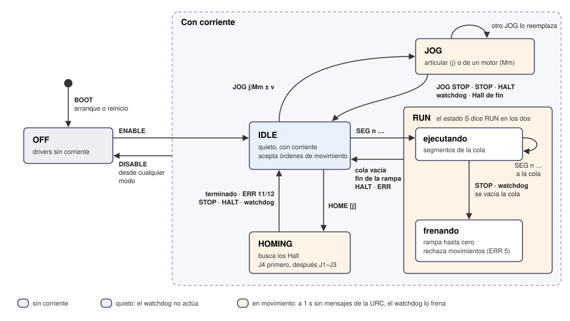<figcaption>Figura 9. Máquina de estados de la UCI: los modos que informa el estado <code>S</code> y las órdenes o eventos que los cambian.</figcaption></figure>

Qué acepta la UCI en cada modo (✓ acepta; el número es el `ERR` con que rechaza):

| Orden | `OFF` | `IDLE` | `JOG` | `RUN` (ejecutando) | `RUN` (frenando) | `HOMING` |
| --- | --- | --- | --- | --- | --- | --- |
| `HELLO`, `PING`, `STATUS` | ✓ | ✓ | ✓ | ✓ | ✓ | ✓ |
| `ENABLE`, `DISABLE`, `STOP`, `HALT`, `JOG STOP` | ✓ | ✓ | ✓ | ✓ | ✓ | ✓ |
| `JOG j/Mm ± v` | 6 | ✓ | ✓ (reemplaza) | 5 | 5 | 5 |
| `ZERO`, `HOME [j]` | 6 | ✓ | 5 | 5 | 5 | 5 |
| `SEG …` | 6 | ✓ (7 sin referencia) | 5 | ✓ (cola) | 5 | 5 |

La referencia se **pierde** con `DISABLE`, con `HALT` en movimiento, con un `BOOT` y con un homing abortado o frenado (solo los ejes de ese `HOME`); se **conserva** con `STOP`, `JOG STOP` y el watchdog, que frenan sin perder pasos.

### 3.7 `scara/1`: temporización y control de flujo

| Parámetro | Valor | Quién |
| --- | --- | --- |
| Período del estado `S` | 50 ms (20 por segundo) | UCI |
| Período del `PING` | 250 ms, en tiempo real | URC |
| Watchdog | 1 s sin una línea completa de la URC, solo con el robot en `JOG`, `RUN` o `HOMING` | UCI |
| Duración de un segmento | 20 ms (la URC muestrea el perfil cada 20 ms) | URC |
| Cola de segmentos | 16 lugares, el que se ejecuta incluido | UCI |
| Segmentos en cola durante el jog verificado | 3 | URC |
| Renovación del jog desde la página | cada 150 ms; sin renovar 500 ms, la URC lo frena | Página y URC |
| Búsqueda de homing | 60 s por eje como máximo | UCI |

**Control de flujo.** La URC envía un `SEG` y **espera su `OK` antes de enviar el siguiente**. Mientras haya lugar, el `OK` sale enseguida; con la cola llena, el firmware **retiene** el segmento recibido y demora su `OK` hasta que termine el que se ejecuta. Así la URC nunca envía de más, y un `SEG` antes de ese `OK` es un error de la URC (`ERR 9 cola`). A 50 segmentos por segundo son unos 2 KB/s, contra los ~11 KB/s del enlace serie a 115 200 baudios.

**El reloj lo pone el firmware.** Un segmento empieza cuando termina el anterior, no cuando llega: una demora del enlace no se nota mientras quede cola (16 × 20 ms = 320 ms de margen). Si la cola se vacía, el robot se queda en el último destino; por eso la URC planifica cada tramo hasta velocidad cero. En Webots el reloj del firmware es el de la simulación, y por eso Webots debe correr a 1× o menos: acelerado, el watchdog (tiempo simulado) se adelanta a los `PING` (tiempo real) y frena el robot con `ERR 4`.

**Números de segmento.** La URC no los repite en una sesión: un `OK` que llega tarde, después de un `STOP`, no se confunde con el de un tramo nuevo. El campo `último` de `S` dice hasta dónde llegó el tramo.

### 3.8 `scara/1`: diálogos reales

Las transcripciones siguientes son **tráfico real** entre la URC y el gemelo en Webots, registrado sin alterar ningún byte. La primera columna es el tiempo en segundos desde el inicio del registro. Se omitieron los `PING` y los estados `S` repetidos que no aportan; los `(…)` son comentarios.

**Apertura de la sesión.** El controlador de Webots se conecta, el firmware arranca y la URC saluda. El primer `S` dice: sin corriente, sin referencia, todo en 0 (la cuenta empieza en el arranque) y el Hall de J4 activo (`hall` = 8).

```text
   3.332  URC → UCI  HELLO
   3.332  URC → UCI  PING
   3.334  UCI → URC  BOOT scara/1 1
   3.337  UCI → URC  HI scara/1 1
   3.386  UCI → URC  S OFF 0 0 0 0 0 8 16 0
```

**Orden rechazada, habilitar y jog sin referencia.** El jog sin corriente se rechaza; con corriente, el firmware lo limita a 500 centésimas por segundo (5 °/s) porque no hay referencia. J1 avanza ~2,25° cada 450 ms; al soltar la tecla, la URC envía `JOG STOP`.

```text
  34.690  URC → UCI  JOG 1 + 500
  34.692  UCI → URC  ERR 6 deshabilitado
  35.045  URC → UCI  ENABLE
  36.044  URC → UCI  JOG 1 + 500
  36.093  UCI → URC  S JOG 0 23 0 0 0 8 16 0
  36.549  UCI → URC  S JOG 0 248 0 0 0 8 16 0
  37.091  UCI → URC  S JOG 0 495 0 0 0 8 16 0
  37.141  URC → UCI  JOG STOP
```

**Homing.** Una sola orden; la UCI busca los cuatro ejes sola y avisa cada uno. Al terminar, los ejes quedan en los flancos de referencia (J1 y J2 en −129,99°, J3 en −145,01°, J4 en 3,00 mm), `ref` = 15 y todos los Hall activos.

```text
  38.165  URC → UCI  HOME
  38.216  UCI → URC  S HOMING 0 523 0 0 -5 8 16 0      (J4 sube; siguen los PING)
  56.630  UCI → URC  EV HOMED 4
  70.212  UCI → URC  EV HOMED 1
  82.901  UCI → URC  EV HOMED 2
  96.249  UCI → URC  EV HOMED 3
  96.282  UCI → URC  S IDLE 15 -12999 -12999 -14501 300 15 16 0
```

**Tramo PTP y control de flujo.** La URC vuelve sola al reposo: un PTP de 178 segmentos de 20 ms (3,56 s). Mientras hay lugar en la cola, cada `OK` sale en ~2 ms. Con la cola llena, a partir del segmento 18, el firmware retiene cada `SEG` y su `OK` sale recién cuando termina el que se ejecuta: los `OK` pasan a espaciarse ~20 ms, el ritmo de la ejecución.

```text
  96.331  URC → UCI  SEG 1 20 -12998 -12998 -14499 301
  96.333  UCI → URC  OK 1
  96.333  URC → UCI  SEG 2 20 -12993 -12993 -14495 305
  96.335  UCI → URC  OK 2
      …
  96.365  URC → UCI  SEG 18 20 -12545 -12545 -13995 708
  96.373  UCI → URC  OK 18                                   (cola llena)
  96.373  URC → UCI  SEG 19 20 -12494 -12494 -13937 755
  96.393  UCI → URC  OK 19                                   (20 ms después)
  96.393  URC → UCI  SEG 20 20 -12439 -12439 -13876 804
  96.418  UCI → URC  OK 20
```

**Jog verificado (con referencia).** Con referencia, el jog ya no es la orden `JOG`: la URC planifica segmentos de 20 ms de 0,2° cada uno (10 °/s), verifica cada uno contra límites, alcance, codo y choques, y mantiene **tres** en la cola (`libres` = 13).

```text
 111.914  URC → UCI  SEG 179 20 20 0 0 12000
 111.916  UCI → URC  OK 179
 111.918  URC → UCI  SEG 180 20 40 0 0 12000
 111.921  UCI → URC  OK 180
 111.922  URC → UCI  SEG 181 20 60 0 0 12000
 111.922  UCI → URC  OK 181
      …
 111.963  UCI → URC  S RUN 15 45 0 0 12000 8 13 180
 111.979  URC → UCI  SEG 184 20 120 0 0 12000
```

**Pérdida de pasos detectada (falla F1).** Por el banco se cargaron 5 kg y se bajó la corriente de M4 al 50 %: J4 no pudo subir y la planta perdió pasos que el firmware no vio (la posición estimada decía J4 = 10 mm; la física seguía en 60 mm). Al volver al reposo, J4 baja y el firmware lo descubre cuando el Hall de abajo se activa antes de lo que esperaba su cuenta: con J4 estimado en 66,91 mm, no en 117 mm.

```text
 174.540  UCI → URC  S RUN 15 0 0 0 6492 0 0 1703
 174.552  URC → UCI  SEG 1720 20 0 0 0 7813
 174.594  UCI → URC  EV LOST 4 1254
 174.594  UCI → URC  S RUN 15 0 0 0 6691 8 0 1705
```

El firmware no corrige la cuenta ni frena: la URC marca la referencia de J4 como **dudosa**, avisa y bloquea la reproducción hasta un homing (Figura 7). La planta había perdido 1252 pasos completos; el error de 2 pasos es el que se espera a 40 mm/s, porque entre dos lecturas del Hall (2 ms) J4 avanza 0,08 mm.

**Reinicio inesperado de la UCI (falla F5).** Sin cortar la conexión, el firmware vuelve a arrancar: `BOOT` en medio de la sesión. La URC lo marca «BOOT inesperado», descarta lo pendiente y da al robot por no referenciado; la UCI quedó sin corriente.

```text
 207.510  UCI → URC  S IDLE 15 0 0 0 12000 8 16 1781
 207.563  UCI → URC  BOOT scara/1 1
 207.623  UCI → URC  S OFF 0 0 0 0 0 8 16 0
```

**Otros diálogos, de las conversaciones de conformidad.** Estos se ejecutan como pruebas automáticas (sección 3.12) y documentan casos que conviene no provocar en vivo:

```text
(corte de la URC en pleno jog)
URC → UCI  JOG 1 + 450
           … más de 1 s sin mensajes …
UCI → URC  ERR 4 watchdog
UCI → URC  S IDLE 0 900 0 0 0 0 16 0

(STOP con rampa a mitad de un segmento de J1 a 18 °/s)
URC → UCI  SEG 1 1000 1800 0 0 12000
UCI → URC  OK 1
URC → UCI  STOP                                  (a los 500 ms, con J1 en 9°)
UCI → URC  S RUN 15 990 0 0 12000 0 16 0     (frenando, cola vacía)
UCI → URC  S IDLE 15 1018 0 0 12000 0 16 0    (129 ms después; v²/2a)

(Hall de J1 trabado activo)
URC → UCI  HOME
UCI → URC  EV HOMED 4
UCI → URC  ERR 12 trabado
UCI → URC  S IDLE 0 -602 0 0 300 9 16 0          (sin referencia, ni siquiera J4)

(mensajes mal formados; la UCI responde y sigue)
URC → UCI  MOVER 1          UCI → URC  ERR 1 comando
URC → UCI  JOG 5 + 100      UCI → URC  ERR 2 argumentos
URC → UCI  JOG 1 + 1001     UCI → URC  ERR 2 argumentos
URC → UCI  HELLO ñ          UCI → URC  ERR 1 comando
```

### 3.9 `scara/1`: robustez

- **Ningún lado se cuelga con una línea inválida.** La UCI responde `ERR` y sigue; la URC registra la línea como «no entendida» y sigue.
- **La URC nunca envía una orden que el firmware rechazaría por su forma**: la revisa antes con la misma gramática (`urc/protocol.py`), y las conversaciones de conformidad lo verifican.
- **Corte del enlace (F4).** Si la URC deja de hablar, el watchdog frena el robot en 1 s; la referencia se conserva porque frenar no pierde pasos. Si la conexión TCP se cae, la URC cancela los segmentos pendientes y espera la reconexión; el controlador de Webots reintenta cada segundo y vuelve sin `BOOT`.
- **Todo `BOOT` significa robot sin referencia.** Con USB, abrir el puerto reinicia la mayoría de los Arduino: la URC nunca supone que el robot sigue referenciado después de una reconexión.
- **Tres frenos para el jog**: la página deja de renovar el pedido al soltar la tecla, perder el foco u ocultarse; la URC frena el jog si no se renovó en 500 ms; y la UCI frena sola a 1 s sin mensajes.

### 3.10 `scara-sim/1`: el canal de instrumentación

Solo existe en la simulación. Mismo estilo que `scara/1` (ASCII, una línea por mensaje terminada en LF, campos separados por espacios), por otro puerto: **TCP 9001**, con la **URC como servidor** y el **controlador de Webots como cliente** (se desactiva con `--sim-port 0`). La UCI real no lo tiene; sin él, la URC funciona igual y el banco de ensayo no aparece.

**Roles.** El controlador de Webots informa el estado del simulador por su cuenta, 20 veces por segundo; la URC envía órdenes del banco de ensayo. No hay acuse por orden: la URC **confirma** cada orden viendo el cambio en el estado `SIM`, y si no lo ve en 2 s, lo avisa en el registro de eventos. Las órdenes que no se ven en el estado (`MANO`, `EMPUJON`) tienen eco.

**Del controlador a la URC:**

| Mensaje | Sintaxis | Significado |
| --- | --- | --- |
| Saludo | `SIM HELLO scara-sim/1` | Al conectarse. |
| Estado | `SIM J1 J2 J3 J4 hall corriente f2 f3 f4 carga i1 i2 i3 i4 p1 p2 p3 p4` | Cada 50 ms (19 campos). |
| Obstáculo | `SIM OBSTACULO tipo X Y altura` | Cada 50 ms: `ninguno`, `maceta` o `mesa`; mm. |
| Contacto | `SIM CONTACTO tipo cuerpo e1 e2 e3 e4 p1 p2 p3 p4 l1 l2 l3 l4` | Cada 50 ms: cuerpo en contacto (`ninguno`, `ARM`, `FOREARM`, `WRIST`, `TOOL`); esfuerzo actual, pico y límite provisional por articulación (N·m en J1–J3; N en J4). |
| Ecos | `SIM MANO j posición`, `SIM EMPUJON f dir ms` | Orden aplicada. |
| Rechazo | `SIM ERR orden`, `SIM ERR corriente`, `SIM ERR posicion` | Orden desconocida o mal formada; `MANO` con algún driver con corriente; `MANO` fuera de los límites. |

Campos del estado `SIM`:

| Campo | Significado |
| --- | --- |
| `J1`–`J4` | **Posición física simulada**, leída de los `PositionSensor` de Webots, en unidades de `scara/1`. |
| `hall` | Los Hall tal como los ve el firmware (con las fallas F3 aplicadas). |
| `corriente` | Máscara de drivers con corriente (bit 0 = M1); 15 = todos. |
| `f2`, `f4` | Falla F2 (driver de M4 sin corriente) y F4 (enlace `scara/1` cortado): 0 o 1. |
| `f3` | Cuatro caracteres, uno por articulación: `-` Hall libre, `A` trabado activo, `I` trabado inactivo. |
| `carga` | Gramos agregados a la herramienta, sin el pistón y su soporte (150 g): 0–4850, para no pasar de 5 kg. |
| `i1`–`i4` | Corriente de cada driver, en % de la nominal (F1). |
| `p1`–`p4` | Pasos completos que perdió cada motor desde el último homing de su eje o desde que recuperó la corriente. |

**De la URC al controlador:**

| Orden | Parámetros | Efecto |
| --- | --- | --- |
| `F1 m %` | Motor 1–4; 10–100 % | Baja la corriente del driver de `m`: el motor tiene menos par y puede perder pasos. |
| `F2 0\|1` | — | Deja sin corriente el driver de M4: J4 cae por su peso; la posición estimada no cambia. |
| `F3 j estado` | Articulación 1–4; `activo`, `inactivo` o `libre` | Traba el Hall de `j` o lo devuelve a la geometría. |
| `F4 0\|1` | — | Corta `scara/1` sin cerrar la conexión TCP, como un cable desenchufado: lo que entra se pierde y lo que sale no llega. Actúa el watchdog. |
| `F5` | — | Reinicia el firmware de la UCI: `BOOT` inesperado, sin corriente ni referencia. |
| `CARGA g` | 0–4850 | Masa que se suma a la herramienta, en el extremo de J4 (el pistón y su soporte, 150 g): con 4850 g el conjunto llega a 5 kg, la masa con la que se verificaron los límites de los motores. Fuera de ese rango, la URC no la envía y el controlador la rechaza con `SIM ERR orden`. |
| `RECARGA` | — | Recarga el mundo de Webots; los dos canales se vuelven a conectar. |
| `OBSTACULO …` | `ninguno` · `maceta X Y` · `mesa X Y altura` (X, Y: ±1000 mm; altura: −20 a 90 mm) | Pone o saca un obstáculo físico (pruebas C1 y C2). |
| `EMPUJON f dir ms` | Fuerza en centinewtons 1–5000; dirección −180 a 180°; duración 50–2000 ms | Empujón horizontal breve en la punta (prueba C3). |
| `MANO j pos` | Articulación 1–4; posición en centésimas, dentro de los límites | Lleva la articulación a mano, solo con los cuatro drivers sin corriente (prueba C4). |

Diálogo real: la apertura del canal y la inyección de F1 con carga. Al `F1 4 50` el estado responde con `i4` = 50 en el siguiente `SIM`, y la URC da la orden por confirmada:

```text
  3.334  UCI → URC  SIM HELLO scara-sim/1
  3.334  UCI → URC  SIM 966 123 -228 12000 8 0 0 ---- 0 0 100 100 100 100 0 0 0 0
164.753  URC → UCI  CARGA 4850
164.770  URC → UCI  F1 4 50
164.782  UCI → URC  SIM -2 -1 -3 6001 0 15 0 ---- 0 4850 100 100 100 50 0 0 0 0
174.420  UCI → URC  SIM -2 -1 -3 11064 0 15 0 ---- 0 4850 100 100 100 100 0 0 0 1252
```

La primera línea de estado muestra el desvío con que arranca el mundo (J1 = 9,66°, J2 = 1,23°, J3 = −2,28°) y la última, los 1252 pasos que perdió M4: es lo que el `EV LOST 4 1254` de `scara/1` delató sin ver este canal.

### 3.11 La API HTTP de la URC

La página y la URC se comunican por HTTP con JSON, en `127.0.0.1:8766`. No es parte del contrato con la máquina, pero completa el recorrido de una orden: tecla → `POST /api/jog` → `SEG` o `JOG` → motor. Las órdenes son `POST` con `Content-Type: application/json` y un cuerpo de hasta 1 KiB; la URC rechaza las que vienen de otro origen (403).

| Método y ruta | Uso |
| --- | --- |
| `GET /` y los `.js` | La página. |
| `GET /api/estado` | Estado de la sesión: enlace, último `S`, referencia, dudas, homing, tramo en curso y las últimas 40 líneas de tráfico `scara/1`, sin los `S` ni los `OK`. |
| `GET /api/eventos?desde=v` | Registro de eventos desde la versión `v`. |
| `GET /api/banco`, `/api/trayectoria`, `/api/trayectorias`, `/api/reproduccion` | Banco de ensayo, trayectoria abierta, archivos disponibles y estado de la reproducción. |
| `POST /api/enable`, `/disable`, `/home`, `/zero`, `/park`, `/stop`, `/halt` | Órdenes sin parámetros. |
| `POST /api/jog`, `/api/jog/stop` | `{"joint": 1, "direction": "+", "mode": "articular", "motor": false, "slow": false}`, renovado cada 150 ms. |
| `POST /api/ptp` | `{"joints": [J1, J2, J3, J4]}` o `{"pose": {"x", "y", "z", "heading"}}`, `speed` %, y `confirm`: sin él, solo planifica y devuelve la duración. |
| `POST /api/trayectoria/…` | `capturar`, `punto`, `editar`, `sobrescribir`, `borrar`, `mover`, `ir`, `nueva`, `guardar`, `cargar`. |
| `POST /api/reproduccion/…` | `reproducir` (`start`, `speed` 10–100, `loops`), `pausa`, `reanudar`, `stop`. |
| `POST /api/banco` | Órdenes del banco, que la URC traduce a `scara-sim/1`. |

Respuestas: 202 si la orden se envió, 200 con el plan si fue una consulta, 400 con `error` (una línea) y `detail` (el porqué, plegado en la página) si se rechazó, y 409 si la UCI no está conectada o la URC necesita una confirmación.

### 3.12 Conformidad: un protocolo, dos implementaciones

Los dos lados de `scara/1` están escritos en lenguajes distintos (C++ y Python). Para que no lo entiendan de maneras distintas, las **24 conversaciones de conformidad** de `firmware/test/conversaciones/` son la definición ejecutable del protocolo y se corren contra los dos:

- **Contra el firmware:** el núcleo C++ real, compilado para la PC con una capa de hardware falsa (reloj controlable, contadores de pasos, imanes con la misma geometría que Webots, Hall trabados y pasos perdidos a voluntad), recibe las órdenes `>` y tiene que responder exactamente las líneas `<`.
- **Contra la URC:** una UCI falsa en Python se conecta por TCP a la URC real y le envía las líneas `<`; la URC tiene que entenderlas y poder enviar cada `>`, salvo las que el firmware rechaza por su forma, que tiene que negarse a enviar con el mismo código.

Cubren saludo, estado periódico, errores, habilitar, `ZERO`, jog articular y por motor, Hall de fin de carrera, `STOP`/`HALT`, watchdog, reinicio, segmentos (interpolación, cola, demora, errores, `STOP` y watchdog con segmentos), homing (normal, repetido, Hall ausente y trabado) y pérdida de pasos (también con el acople M1/M2).

### 3.13 Cómo probarlo a mano

Sin la URC, el protocolo se puede hablar a mano. Con `nc` escuchando en el 9000 y Webots abierto (ejemplo ilustrativo: los números dependen del desvío con que arranca el mundo):

```text
$ nc -l 9000
BOOT scara/1 1
S OFF 0 0 0 0 0 8 16 0
ENABLE                         (escrito a mano)
ZERO
S IDLE 15 0 0 0 12000 8 16 0
JOG 1 + 450
S JOG 15 22 0 0 12000 8 16 0
JOG STOP
```

Hay que escribir `PING` al menos una vez por segundo mientras el robot se mueve, o el watchdog lo frena. Con el robot real, el monitor serie del IDE de Arduino a 115 200 baudios cumple el mismo papel.

<!-- SALTO DE PAGINA -->

## 4. Interconexión lógica

### 4.1 Diagrama original: el equipo físico con el software externo

Como el SCARA no está construido, el «original» es el diseño previsto: el que describe el maestro v1 (mecánica, motores, drivers, UNO, fuentes) completado por el grupo con el protocolo, la URC y la ubicación de los sensores. Con la placa real, socat puentea el USB-serie del UNO al TCP 9000 donde escucha la URC.

<figure class="ancha">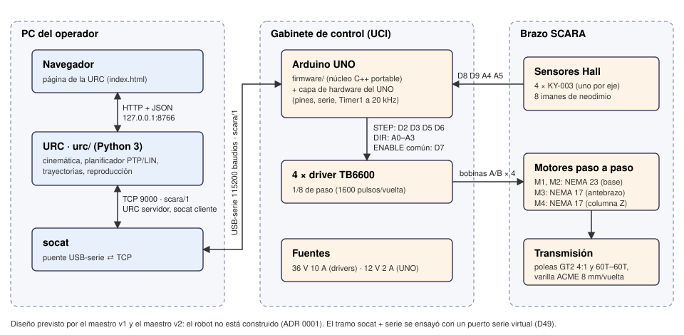<figcaption>Figura 10. Interconexión del equipo físico (previsto) con el software externo.</figcaption></figure>

### 4.2 Diagrama con el gemelo digital

Webots reemplaza al gabinete y al brazo. El navegador, la URC y `scara/1` no cambian: el controlador `scara_uci` se conecta al mismo puerto 9000 que usaría socat. Dentro del controlador corre el **mismo firmware** del UNO; lo que cambia es la capa de hardware (`WebotsHal`: reloj simulado, cliente TCP, pasos y Hall) y la **planta simulada**, que reemplaza a drivers, motores, transmisión y sensores y mueve las articulaciones de Webots por su API. Se agregan dos componentes que solo existen en la simulación: el canal `scara-sim/1` (9001) y el banco de ensayo de la página.

<figure class="ancha">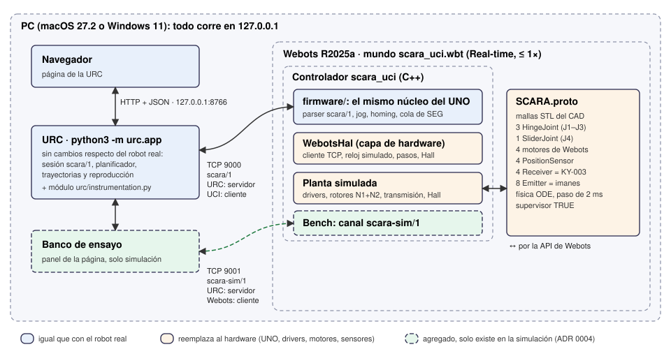<figcaption>Figura 11. Interconexión del software externo con el gemelo digital.</figcaption></figure>

| Componente | Robot real (previsto) | Gemelo digital |
| --- | --- | --- |
| Programa externo | URC + navegador | La misma URC, sin cambios |
| Transporte de `scara/1` | USB-serie 115 200 + socat → TCP 9000 | TCP 9000 directo desde el controlador |
| Firmware | `firmware/` en el UNO | El mismo `firmware/` dentro de `scara_uci` |
| Capa de hardware | Pines, `Serial`, Timer1 | `WebotsHal`: reloj de la simulación, socket TCP no bloqueante |
| Drivers, motores, transmisión | TB6600, NEMA 23/17, poleas GT2, ACME | Planta simulada: rotores N1 + N2, acople M1/M2, motores de Webots |
| Sensores Hall | KY-003 e imanes | `Receiver` y `Emitter`, activados por distancia |
| Instrumentación | — | `PositionSensor` + `scara-sim/1` + banco de ensayo |

<!-- SALTO DE PAGINA -->

## 5. Pila tecnológica

### 5.1 Sistemas operativos y simulador

| Componente | Versión | Uso |
| --- | --- | --- |
| macOS | 27.2 (Apple Silicon) | Desarrollo y ensayos en Webots |
| Windows | 11 | Desarrollo y ensayos en Webots |
| **Webots** | **R2025a** | Simulador: mundo `scara_uci.wbt`, proto `SCARA.proto` y controlador `scara_uci`; física ODE con paso de 2 ms |
| Arduino UNO | — | Destino del firmware (compila; no hay placa) |

### 5.2 Lenguajes y componentes de software

| Componente | Lenguaje | Detalle |
| --- | --- | --- |
| Firmware (`firmware/`) | C++ (subconjunto para AVR: sin memoria dinámica ni flotantes) | Compila con Apple Clang 21 / g++ 14.2 (MSYS2 de Webots) para la PC y con `arduino-cli` para el UNO |
| Controlador de Webots (`webots/controllers/scara_uci/`) | C++ | API C++ de Webots; capa de hardware, planta simulada y canal de instrumentación |
| URC (`urc/`) | Python 3, solo biblioteca estándar | Servidor HTTP, sesión `scara/1`, planificador, trayectorias, reproducción |
| Página de la URC | HTML, CSS y JavaScript sin frameworks | `urc/index.html` y tres scripts |
| Cinemática y colisiones (`scara/`) | Python 3 | Compartidas por la URC y las herramientas |
| Pruebas | Python `unittest` | Pruebas automáticas del firmware, la URC y el protocolo |

### 5.3 IDEs: ¿para qué se usaron?

| Herramienta | Para qué |
| --- | --- |
| Editor de Webots | Abrir el mundo, compilar el controlador (Build) y ver la simulación |
| Orca | Entorno de trabajo con copias aisladas del repositorio (*worktrees*) por tarea y terminales para los agentes de IA |
| VS Code | Edición del código (C++, Python, HTML/JS) y de la documentación, y revisión de los cambios antes de cada commit |
| Terminal (zsh, PowerShell) | Compilar con `make`, correr la URC y las pruebas |

### 5.4 Modeladores 3D: ¿para qué se usaron?

| Herramienta | Para qué |
| --- | --- |
| SolidWorks | Fuente de verdad del diseño (piezas `.SLDPRT`, ensambles `.SLDASM` y planos de la cátedra, en `Modelos3D/`). El grupo no los modificó. |
| sldprt2step (revisión fijada, Apache-2.0) | Convertir las piezas de SolidWorks a STEP sin SolidWorks, con dos adaptadores propios documentados |
| OpenCascade (OCP 8.0.1, sin VTK) | Validar los BREP, calcular volúmenes, centros de masa e inercias, y teselar a STL en metros para Webots |
| Onshape | Contraste independiente de medidas (distancia entre agujeros del brazo) |

No se usaron Blender ni CadQuery completo.

### 5.5 IAs y licencias: ¿para qué se usaron?

| Herramienta | Licencia | Para qué |
| --- | --- | --- |
| Claude Code (Anthropic), con los modelos Claude Opus 5.5, Sonnet 5.5, Haiku 5.5. | Suscripción comercial. | Asistencia en la implementación (firmware, URC, planta, pruebas), la redacción de la documentación y los informes, la investigación de fuentes y la revisión de código. Los commits asistidos llevan la línea `Co-Authored-By` del modelo. |

Las decisiones de diseño fueron del grupo, y lo que dependía del profesor se consultó en clase. Lo que produjo la IA se aceptó solo después de verificarlo con pruebas automáticas y ensayos en Webots.

Licencias de los componentes de terceros: Webots (Apache-2.0), sldprt2step (Apache-2.0, con su `LICENSE` y `NOTICE` en `tools/patches/`), OpenCascade (LGPL-2.1 con excepción), socat (GPL-2.0), Python (PSF). SolidWorks y los modelos son de la cátedra.

### 5.6 Otros componentes

| Componente | Para qué |
| --- | --- |
| socat | Puente USB-serie ⇄ TCP para el robot real; ensayado con un puerto serie virtual |
| netcat (`nc`) | Hablar `scara/1` a mano frente a Webots |
| `arduino-cli` | Compilar el firmware para el UNO y verificar su presupuesto de flash y RAM |
| `tools/espiar_enlace.py` | Registrador interpuesto en los enlaces 9000 y 9001 (diálogos de la sección 3.8) |
| Git, GitHub y `gh` | Repositorio privado, issues como especificación de cada tarea, pull requests |

<!-- SALTO DE PAGINA -->

## 6. Observaciones finales

### 6.1 Resultados

Se cumplió lo que pide la consigna para el SCARA: el modelo físico en Webots (`.wbt` y proto), el controlador en C++, un programa externo visual (la página de la URC) que **registra puntos de una trayectoria y luego la ejecuta**, y la comunicación por TCP/IP con mensajes de texto claro regulados por un protocolo propio, `scara/1`, especificado y probado contra las dos implementaciones.

Más allá del mínimo:

- **El mismo firmware para el robot y para la simulación.** El código que corre en Webots compila para el Arduino UNO dentro de su presupuesto. El día que el robot exista, Webots se reemplaza por el UNO y socat sin cambiar la URC.
- **Un gemelo que se comporta como un robot sin encoders.** La posición se estima por pasos, la referencia sale de un homing con sensores Hall, y un motor puede perder pasos sin que el firmware lo sepa hasta cruzar un imán.
- **Teach & play completo:** jog articular, cartesiano y por motor; captura y edición de puntos; tramos LIN (recta del extremo) y PTP (menor recorrido); validación previa de toda la trayectoria (límites, alcance, velocidades, codo y colisiones); reproducción con loop, pausa y stop.
- **Fallas reproducibles** F1–F5 y pruebas físicas del entorno C1–C4 (choque con una maceta, J4 contra una mesa, empujón en la punta, movido a mano sin corriente).

### 6.2 ¿Qué quedó pendiente de implementación?

- **El electroimán del extremo.** La consigna anticipa «un sencillo electroimán, para demostraciones de pick & place». No está en el CAD ni en el maestro, y quedó fuera de alcance: las trayectorias de *pick and place* mueven el punto de herramienta, pero no toman ni sueltan nada.
- **Probar con la placa real.** El firmware compila para el UNO y el camino serie se ensayó con un puerto virtual y socat, pero no hay robot ni placa.
- **Medir los parámetros del robot real.** El par de los motores se tomó de la familia más cercana porque sus hojas de datos no aparecieron, y las envolventes de colisión son cajas simplificadas.
- **Simular fallas de la transmisión** (una correa que patina o se corta) **y el comportamiento eléctrico de los motores**.

### 6.3 ¿Qué se podría mejorar en una próxima iteración?

- **Agregar el electroimán**: un nodo `Connector` en el proto y una orden nueva en `scara/1` (por ejemplo, `TOOL 0|1`), agregada al final sin romper la versión 1, con su conversación de conformidad; y un tipo de punto «tomar/soltar» en el gestor de trayectorias.
- **Hardware en el lazo:** conectar un UNO real por socat a la planta de Webots, para ensayar los tiempos del Timer1 y del enlace serie sin construir el brazo.
- **Desacoplar el watchdog de la velocidad de Webots**, para poder correr la simulación acelerada en los ensayos largos sin abortos.
- **Encoders o un sensor por motor**, si se construye el robot: hoy un paso perdido se descubre recién al cruzar un imán.
- **Ver la escena de Webots en la página de la URC** (*streaming* de la vista), para operar desde una sola ventana.
- **Calibrar con el robot construido:** reemplazar cada parámetro provisional por una medición, empezando por el par de los motores y las masas.

<!-- SALTO DE PAGINA -->

## Anexo A. Archivos entregados y cómo ejecutarlos

| Qué | Dónde |
| --- | --- |
| Modelo físico (mundo de Webots) | `webots/worlds/scara_uci.wbt`, con el robot en `webots/protos/SCARA.proto` y las mallas en `cad/derivados/stl/` |
| Controlador (C++) | `webots/controllers/scara_uci/scara_uci.cpp` y `stepper.h` (planta), más el firmware de `firmware/` |
| Programa externo | `urc/` (URC y página) |
| Firmware para el UNO | `firmware/arduino/scara_uci/` |
| Trayectorias de demostración | `trayectorias/demo-*.json` |
| Especificaciones del protocolo | `docs/PROTOCOLO_SCARA_1.md`, `docs/PROTOCOLO_SCARA_SIM_1.md`, `firmware/test/conversaciones/` |
| Evidencia de la validación | `validation/campana/` (informe, `campana.json` y registros) |
| Este informe | `docs/informe/INFORME-SCARA.md`, exportado a `output/docx/SCARA-Informe-Gemelos-Digitales.docx` |

Primera ejecución, desde la raíz del repositorio:

1. Compilar el controlador (macOS): `WEBOTS_HOME=/Applications/Webots.app make -C webots/controllers/scara_uci`.
2. Levantar la URC: `python3 -m urc.app`, y abrir `http://127.0.0.1:8766`.
3. En Webots, abrir `webots/worlds/scara_uci.wbt` en **Real-time** (a 1× o menos).
4. En la página: «Habilitar motores», «Homing…», y cargar y reproducir una demostración.
